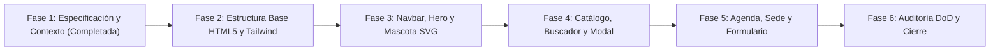

# Flujo de Trabajo y Definition of Done - ITecnoFuturo

> **Estándar SDD (Gentle-AI)** | Metodología de Maquetado Paso a Paso y Criterios de Aceptación.

---

## 1. Fases del Maquetado SDD (Spec-Driven Development)
Siguiendo la metodología de **Gentle-AI**, la construcción del sitio web se ejecuta en fases estrictamente secuenciales para garantizar calidad y cero retrabajo:

### Detalle de las Fases:
- **Fase 1: Especificación y Contexto Vivo [COMPLETADA]**:
  - Definición de los 5 bloques de la entrevista y creación de la suite `docs/contexto/`.
- **Fase 2: Estructura Base y Configuración Tailwind**:
  - Creación de `index.html` con etiquetas meta de viewport, preconnect a Google Fonts (Inter) y script de CDN de Tailwind CSS con paleta y dark mode inyectados.
- **Fase 3: Header, Navbar Responsive y Hero**:
  - Maquetado del navbar fijo con botón de tema y menú móvil.
  - Maquetado del Hero con robot mascota vectorial animado y botones de acción.
- **Fase 4: Secciones de Contenido y Catálogo Dinámico**:
  - Maquetado de la sección "Sobre ITecnoFuturo" y áreas de exposición.
  - Implementación del motor JavaScript para renderizar las tarjetas de los 6 proyectos con categorías y badges de estado.
  - Programación del buscador en tiempo real y botones de filtro por categoría, integrando el *Empty State*.
  - Programación del modal accesible de ficha técnica con bloqueo de scroll de fondo y soporte de tecla Escape.
- **Fase 5: Agenda, Información Institucional y Formulario**:
  - Implementación de la sección Agenda con pestañas interactivas para Día 1 y Día 2.
  - Sección de sede con detalles del Campus ITec Río Cuarto y horarios.
  - Formulario de inscripción validado con mensaje de confirmación y generación de la credencial digital simulada.
  - Footer con identidad del ITec y aviso de evento ficticio.
- **Fase 6: Auditoría Técnica y Control de Calidad (DoD)**:
  - Verificación en herramientas de desarrollo, emulación responsive en múltiples resoluciones y comprobación de consola limpia.

---

## 2. Definition of Done (DoD) - Criterios de Aceptación
Ninguna entrega se considerará terminada sin la verificación exhaustiva de los siguientes 12 puntos:

- [ ] **1. Archivo Único y Autónomo**: La SPA se ejecuta de inmediato abriendo `index.html` en el navegador, sin necesidad de comandos de instalación previos.
- [ ] **2. HTML5 Semántico**: Empleo riguroso de `<header>`, `<nav>`, `<main>`, `<section>`, `<article>`, `<button>` y `<footer>`.
- [ ] **3. Navegación Fluida (Smooth Scroll)**: Al cliquear enlaces del navbar o botones del hero, el documento se desplaza suavemente hacia el ancla respectiva sin recargar la página.
- [ ] **4. Cuatro Estados UI Obligatorios**:
  - *Loading*: Transiciones suaves de carga y renderizado inicial.
  - *Éxito*: Despliegue correcto de tarjetas y confirmación de inscripción.
  - *Vacío (Empty State)*: Mensaje informativo con botón de reseteo cuando no hay proyectos que coincidan con la búsqueda o filtro.
  - *Error / Validación*: Indicadores visuales claros en campos obligatorios del formulario antes de permitir el registro.
- [ ] **5. Catálogo de Proyectos Funcional**: Renderizado exacto de los 6 proyectos ficticios con títulos, descripciones, categorías, expositores y estados.
- [ ] **6. Modal Accesible de Ficha Técnica**: Abre al pulsar "Ver detalles", se cierra con botón `X`, clic en backdrop o tecla `Escape`, y desactiva el scroll del `<body>` mientras está abierto.
- [ ] **7. Pestañas de Agenda Reactivas**: Cambio instantáneo entre las actividades del Día 1 y Día 2 con indicador de pestaña activa.
- [ ] **8. Menú Móvil Hamburguesa Confiable**: Despliega en pantallas menores a 768px y se repliega automáticamente al tocar cualquier enlace de navegación.
- [ ] **9. Persistencia de Modo Claro / Oscuro**: El cambio de tema no parpadea al refrescar y recuerda la elección del usuario en `localStorage`.
- [ ] **10. Cero Scroll Horizontal**: El viewport móvil permanece firme sin desplazamiento accidental hacia los costados (`overflow-x-hidden`).
- [ ] **11. Accesibilidad y Contraste**: Textos legibles en ambos modos y atributos `alt` descriptivos en todas las imágenes.
- [ ] **12. Consola Cero Errores**: Sin warnings ni excepciones de JavaScript en las herramientas de desarrollo.
